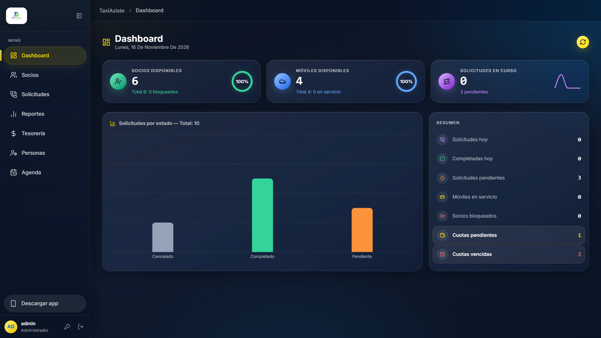
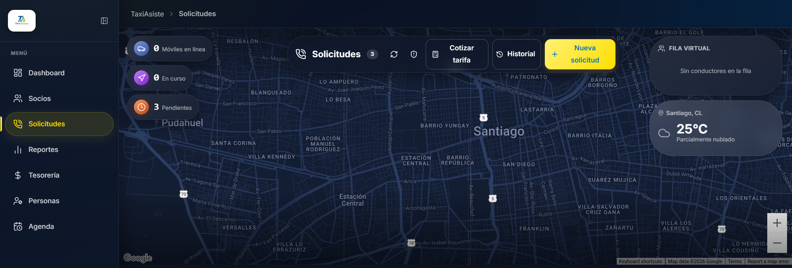
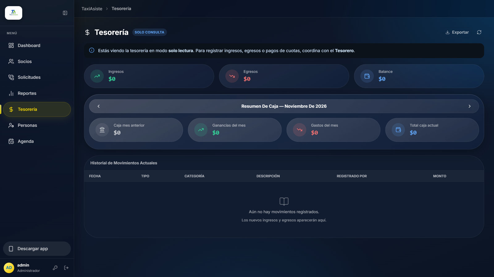
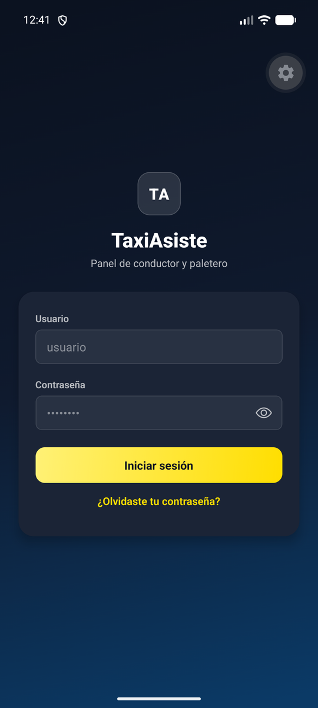
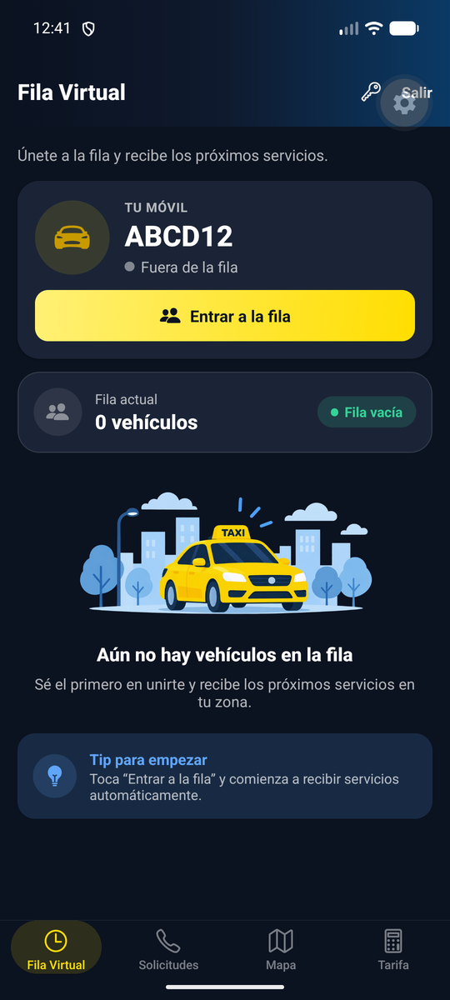
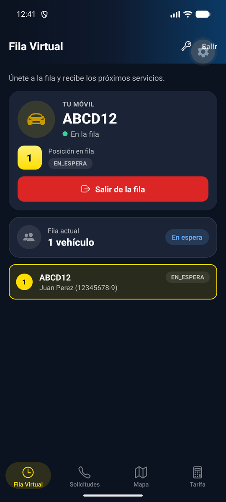

# TaxiAsiste

Plataforma de despacho y administración para un sindicato de taxis: **API REST + panel web + app móvil** que reemplazan la coordinación manual y por radio por un sistema con trazabilidad.

> Proyecto de título (INACAP, Informática y Telecomunicaciones) construido con un cliente real: el sindicato de 27 taxistas que opera junto al Hospital Clínico Félix Bulnes, en Cerro Navia, Santiago de Chile.

**Autor:** Miguel Ángel Contreras Contreras

<p align="center">
  
</p>

---

## El problema

El sindicato agrupa a 27 socios con 27 móviles y, antes de este proyecto, coordinaba los servicios de forma manual y por radio: no existía un registro digital de las solicitudes, de la disponibilidad de los móviles ni de la administración interna (socios, cuotas, bloqueos).

TaxiAsiste digitaliza esa operación de punta a punta:

- **Central** registra y asigna traslados, con la dirección geocodificada y el recorrido en el mapa.
- **Los conductores** reciben servicios y reservas en su teléfono y reportan su posición en vivo.
- **La directiva** administra socios, cuotas, bloqueos y tesorería, con reportes y registro de cambios.

## Funcionalidades

### Implementadas

**Operación de traslados**
- Solicitudes de viaje inmediatas con ciclo de vida completo (pendiente → asignado → en curso → completado o cancelado), registradas por Central y visibles para los conductores.
- Asignación por aceptación del conductor, o manual por Central.
- Reservas programadas, con sus propios estados (programada, asignada, en camino, completada, cancelada, incumplida, pasajero ausente) y trazabilidad de eventos.
- Fila virtual de la base, con vista de Paletero, llamado «Voy» con cuenta regresiva y retiro automático de conductores inactivos.
- Mapa de despacho con la flota en vivo (Google Maps), geocodificación de direcciones y cálculo de rutas desde el backend.
- Cotizador de tarifas por distancia, en el panel y en la app.
- Bloqueo de pasajeros con incumplimientos previos en canales no presenciales.

**App móvil del conductor**
- Seguimiento GPS en segundo plano y pantalla de control de ubicación.
- Mapa de flota y modo «servicio actual» con la ruta al punto de recogida y destino.
- Navegación externa con Waze, llamada al pasajero o a Central y alerta de emergencia.
- Notificaciones locales (llamado de la base, viaje asignado, sesión cerrada desde otro dispositivo).

**Administración y finanzas**
- Socios, cuotas, bloqueos y movimientos de tesorería, con cierre de período y de semana.
- Dashboard, reportes por rol y exportación a Excel.
- Agenda con eventos y documentos.
- Registro de auditoría: quién cambió qué y de qué valor a qué valor.

**Seguridad y cuentas**
- Autenticación JWT con renovación automática de tokens, lista de revocación y cierre de sesión real.
- Sesión única por usuario.
- Cinco roles con permisos distintos (Administrador, Central, Tesorero, Conductor, Paletero) aplicados en la API y en la interfaz.
- Confirmación con contraseña para acciones sensibles, baja lógica de usuarios y recuperación de contraseña por correo.

**Calidad**
- **620 pruebas automatizadas** (473 en el backend, 50 en el panel web y 97 en la app móvil), ejecutadas en CI en cada push.
- Prueba de estrés con Locust: con 100 conductores simulados enviando GPS, 5 usuarios de Central y 20 consultando la fila, la API respondió con p95 de 69 ms y sin errores.
- Scripts para instalar, levantar, probar y respaldar el sistema en un equipo nuevo.

### En desarrollo

- Notificaciones push remotas (hoy son locales; falta integrar Firebase Cloud Messaging).
- Ejecución programada del bloqueo automático de socios morosos (hoy se dispara al cerrar el período).
- Paginación de los endpoints de la API.
- Conexiones persistentes a la base de datos, para mejorar la capacidad bajo carga.
- Logging estructurado y monitoreo de errores.
- Publicación de la app en tienda (hoy se distribuye como APK).

## Stack tecnológico

| Capa | Tecnologías |
|---|---|
| **Backend** | Python 3.12, Django 6, Django REST Framework, SimpleJWT (con blacklist), drf-spectacular (OpenAPI/Swagger), django-cors-headers, python-decouple |
| **Base de datos** | PostgreSQL (esquema versionado con scripts SQL idempotentes) |
| **Panel web** | React 19, TypeScript, Vite, Material UI, Tailwind CSS, React Router, Zustand, React Hook Form + Zod, TanStack Table, Recharts, Axios, ExcelJS, `@react-google-maps/api` |
| **App móvil** | React Native 0.86 con Expo SDK 57, TypeScript, React Navigation, `react-native-maps`, `expo-location` + `expo-task-manager` (GPS en segundo plano), `expo-notifications`, Axios, AsyncStorage |
| **Servicios externos** | Google Maps (Geocoding y Directions desde el backend; mapas en cliente), SMTP para correos |
| **Pruebas y CI** | pytest + pytest-django, Vitest + Testing Library, Jest (jest-expo), Locust, GitHub Actions |

## Arquitectura

```
┌────────────────────┐        ┌────────────────────┐
│   Panel web        │        │   App móvil        │
│ React + TypeScript │        │ React Native/Expo  │
│ (Central, Tesorero,│        │ (Conductor,        │
│  Admin)            │        │  Paletero)         │
└─────────┬──────────┘        └─────────┬──────────┘
          │   HTTPS · JSON · JWT        │
          └──────────────┬──────────────┘
                         ▼
          ┌───────────────────────────────┐
          │  API REST (Django + DRF)      │
          │  usuarios · socios · moviles  │
          │  solicitudes · reportes ·     │
          │  agenda                       │
          └──────┬─────────────────┬──────┘
                 ▼                 ▼
        ┌────────────────┐  ┌──────────────────┐
        │  PostgreSQL    │  │ Google Maps APIs │
        └────────────────┘  │ y servidor SMTP  │
                            └──────────────────┘
```

- **Backend:** una app de Django por dominio (`usuarios`, `socios`, `moviles`, `solicitudes`, `reportes`, `agenda`). La lógica de negocio compleja vive en módulos propios (`fila_logic`, `reservas_logic`, `auditoria`, `confirmacion`) y la documentación interactiva de la API queda en `/api/docs/`. La clave de Google del servidor (Geocoding y Directions) es distinta de las de los clientes y no se expone.
- **Base de datos:** el esquema de negocio se crea con scripts SQL y los modelos de Django están en modo `managed = False`; las pruebas corren contra un PostgreSQL real y separado.
- **Panel web:** páginas por rol, cargadas bajo demanda (`React.lazy`), con rutas protegidas por rol y un tema oscuro de «vidrio» sobre Material UI.
- **App móvil:** navegación por pestañas según el rol, tarea de GPS en segundo plano y notificaciones locales. Comparte con el panel el mismo contrato de API.

## Instalación y ejecución en local

El sistema completo corre en un solo computador con Windows.

**Requisitos:** Git, Python 3.12 o superior, Node.js 20 o superior, PostgreSQL 14 o superior y, solo para la app móvil, Android Studio con un emulador (o un teléfono por USB). Además, una clave de Google Maps propia.

El proyecto se compone de tres repositorios que deben quedar como carpetas hermanas:

```
TaxiAsisteAPP/
├── TaxiAsiste-Backend/
├── TaxiAsiste_Frontend/
└── TaxiAsiste_Mobile/
```

### Opción rápida (automatizada)

```powershell
mkdir C:\TaxiAsisteAPP ; cd C:\TaxiAsisteAPP
git clone https://github.com/Mcontreras-c/TaxiAsiste-Backend.git
cd TaxiAsiste-Backend

.\scripts\entorno_local\preparar_equipo.ps1   # clona los otros dos repos, instala dependencias y crea las bases
.\scripts\entorno_local\levantar_local.ps1    # base de datos, backend (:8000) y panel web (:5173)
```

Para abrir también la app en el emulador: `.\scripts\entorno_local\levantar_local.ps1 -Movil emulador`.
Para ejecutar todas las pruebas: `.\scripts\entorno_local\probar_todo.ps1`.
Los scripts piden la contraseña de PostgreSQL y la clave de Google Maps durante la preparación; **se escriben en los archivos `.env` locales, que nunca se suben al repositorio**.

### Opción manual

**1. Backend**

```powershell
cd TaxiAsiste-Backend
python -m venv venv
.\venv\Scripts\Activate.ps1
pip install -r requirements.txt
copy .env.example .env          # completar SECRET_KEY, POSTGRES_PASSWORD y GOOGLE_MAPS_API_KEY
python scripts/entorno_local/preparar_bd.py    # crea la base, el esquema, las tablas internas de Django y datos de demostración
python manage.py runserver 0.0.0.0:8000
```

La documentación interactiva queda en `http://localhost:8000/api/docs/`.

**2. Panel web**

```powershell
cd TaxiAsiste_Frontend
npm install
# crear .env con:
#   VITE_API_URL=http://localhost:8000/api
#   VITE_GOOGLE_MAPS_API_KEY=<tu clave de navegador>
npm run dev                     # http://localhost:5173
```

**3. App móvil**

```powershell
cd TaxiAsiste_Mobile
npm install
$env:EXPO_PUBLIC_API_BASE_URL = "http://localhost:8000"
adb reverse tcp:8000 tcp:8000   # permite que el emulador llegue al backend local
npx expo run:android            # compila la versión de desarrollo e inicia Metro
```

La app usa `react-native-maps`, un módulo nativo, así que necesita compilarse (`expo run:android`); no funciona con Expo Go.

**Datos de demostración.** El script de preparación crea usuarios ficticios por rol (admin, central, tesorero, conductor y paletero) y unos pocos socios y móviles de ejemplo. Sus credenciales de demostración están en `scripts/entorno_local/LEEME.md` del backend. Son solo para uso local.

**Pruebas**

```powershell
cd TaxiAsiste-Backend ; pytest                    # backend
cd ..\TaxiAsiste_Frontend ; npm test              # panel web
cd ..\TaxiAsiste_Mobile ; npm test                # app móvil
```

## Estructura de carpetas

```
TaxiAsiste-Backend/
├── taxiasiste/
│   ├── usuarios/      roles, autenticación, perfiles, bajas, correos
│   ├── socios/        socios, cuotas, bloqueos, tesorería
│   ├── moviles/       móviles, fila virtual, ubicaciones en vivo
│   ├── solicitudes/   viajes inmediatos, pasajeros y reservas
│   ├── reportes/      dashboard, reportes y auditoría
│   └── agenda/        eventos y documentos
├── scripts/           esquema y migraciones SQL
│   └── entorno_local/ instalación, ejecución, pruebas, estrés y respaldo
└── docs/              documentación de la API

TaxiAsiste_Frontend/
└── src/
    ├── pages/         una pantalla por módulo y rol
    ├── components/    mapa de despacho, diálogos, layout
    ├── api/ store/    cliente HTTP y estado global
    └── theme.ts       tema oscuro de vidrio

TaxiAsiste_Mobile/
└── src/
    ├── screens/       fila virtual, solicitudes, servicio actual, cotizador, paletero
    ├── tasks/         seguimiento GPS en segundo plano
    ├── notifications/ notificaciones locales
    └── navigation/ api/ auth/ components/ utils/
```

## Capturas de pantalla

Todas las capturas usan datos ficticios de demostración.

### Panel web

**Mapa de despacho y solicitudes** (Google Maps, fila virtual y clima)



**Tesorería** (ingresos, egresos y resumen de caja)



### App móvil del conductor

<table>
  <tr>
    <td align="center"><br><sub>Inicio de sesión</sub></td>
    <td align="center"><br><sub>Fila virtual: fuera de la fila</sub></td>
    <td align="center"><br><sub>Fila virtual: en espera, posición 1</sub></td>
  </tr>
</table>

## Autor

**Miguel Ángel Contreras Contreras**
